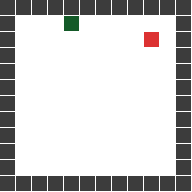
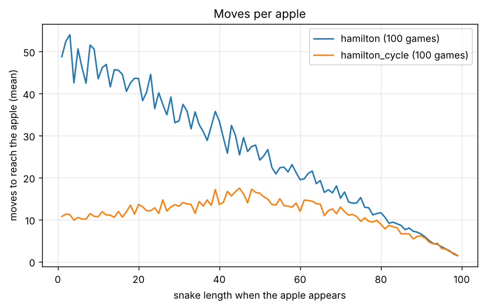
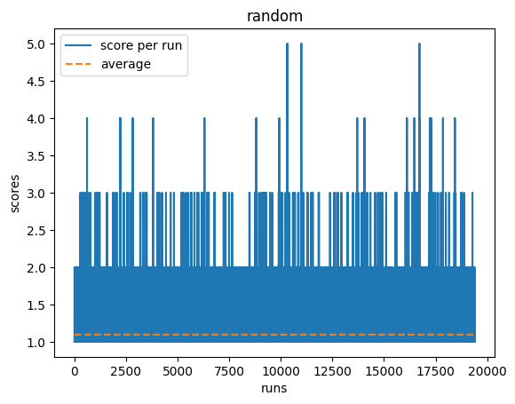

<h3 align="center">
  
</h3>

# Slitherin

AI research environment for the game of Snake written in **Python 3.10+** (migrated from Python 2.7). Part of the [OpenAI - Request For Research 2.0](https://blog.openai.com/requests-for-research-2/).

> **New**: the [Hamilton Cycle](#hamilton-cycle) solver wins every game and needs fewer than half the moves of the original Hamilton solver.

## 🌐 Play in Browser

**NEW**: Try Slitherin directly in your browser! No installation required.

👉 **[Play Online](https://vonalphabiszulu.github.io/slitherin/)** 👈

Watch AI agents solve Snake in real-time with interactive controls and visualization.

Check out corresponding Medium articles:

[Slitherin - Solving the Classic Game of Snake🐍 with AI🤖 (Part 1: Domain Specific Solvers)](https://towardsdatascience.com/slitherin-solving-the-classic-game-of-snake-with-ai-part-1-domain-specific-solvers-d1f5a5ccd635)

[Slitherin - Solving the Classic Game of Snake🐍 with AI🤖 (Part 2: General Purpose Solvers)](https://towardsdatascience.com/slitherin-solving-the-classic-game-of-snake-with-ai-part-2-general-purpose-random-monte-25dc0dd4c4cf)

[Slitherin - Solving the Classic Game of Snake🐍 with AI🤖 (Part 3: Genetic Evolution)](https://towardsdatascience.com/slitherin-solving-the-classic-game-of-snake-with-ai-part-3-genetic-evolution-33186e6be110)


Table of Contents
=================

  * [Usage](#usage)
  * [Rules](#rules)
  * [Modes](#modes)
     * [Domain specific](#domain-specific)
        * [Shortest Path BFS](#shortest-path-bfs)
        * [Shortest Path DFS](#shortest-path-dfs)
        * [Longest path](#longest-path)
        * [Hamilton](#hamilton)
        * [Hamilton Cycle](#hamilton-cycle)
        * [MILP](#milp)
        * [DNN](#dnn)
        * [DNN Monte Carlo](#dnn-monte-carlo)
     * [General purpose](#general-purpose)
        * [Human](#human)
        * [Random](#random)
        * [Monte Carlo](#monte-carlo)
        * [DNN Genetic Evolution](#dnn-genetic-evolution)
  * [Benchmark](#benchmark)
  * [Work in progress](#work-in-progress)

## Usage

### Web Version (Easiest!)

Play directly in your browser: **[https://vonalphabiszulu.github.io/slitherin/](https://vonalphabiszulu.github.io/slitherin/)**

No installation required! Watch AI solvers play Snake with interactive controls.

### Python Version

1. Clone the repo.
2. Go to the project's root folder.
3. Install required packages`pip install -r requirements.txt`.
4. Launch slitherin. I recommend starting with the help mode to see all available modes `python slitherin.py --help`.

## Rules
1. Snake has to move either forward, left or right.
2. Snake dies when hits wall or itself.
3. For every eaten fruit, snake's length increases by 1 and a new fruit is generated on a random unoccupied place.

## Modes
All mode previews contain <span style="color:green">current score</span> **Mode Name (min/avg/max)**.
All modes are benchmarked on a 12x12 grid. The outer ring of tiles is wall, so the snake has 10x10 = 100 tiles and the maximum score is 100.

### Domain specific
> Algorithms are using domain specific data like snake's position, direction, neighbors etc.


#### Shortest Path BFS
`python slitherin.py --shortest_path_bfs`


Generates the shortest path from the snake’s head to the fruit using BFS algorithm.

Optimal performance during early stages, but as the snake grows, its body creates an unavoidable obstacle for the leading head. 

---

#### Shortest Path DFS
`python slitherin.py --shortest_path_dfs`


Generates the shortest path from the snake’s head to the fruit using DFS algorithm.

Performs worse than BFS due to the graph’s cyclicity.

---

#### Longest path
`python slitherin.py --longest_path`


Firstly, generates the shortest path (BFS) between the snake’s head and the fruit. Then for each pair of points in the path, tries to extend the distance between them with available actions.

Snake dies when its body is on a generated path.

---

#### Hamilton
`python slitherin.py --hamilton`


Generates a longest path between the snake’s head and its tail. 

In the vast majority of the cases, such path covers the whole environment creating [Hamiltonian path](https://en.wikipedia.org/wiki/Hamiltonian_path), thus solving the game of snake with a perfect score.

---

#### Hamilton Cycle
`python slitherin.py --hamilton_cycle`




The snake always lies along a [Hamiltonian cycle](https://en.wikipedia.org/wiki/Hamiltonian_path) of the board: a closed loop through every free tile. The head is one point of the loop and the body is the stretch right behind it. The snake always steps to the next tile of the loop, so the tiles it reaches last are the ones its own body leaves, in the order the body leaves them. It can never trap itself, and it wins every game.

Which loop it follows is a free choice, and that choice is what makes it fast. Before every move a local search reshapes the loop so that the apple comes as early on it as possible. One reshaping step cuts the loop at one grid square, which splits off a second loop, and joins the two again at another square. The stretch of loop the snake occupies is never cut, so every reshaped loop is as safe as the one before.

Measured over 100 games on the default board (`python benchmark.py hamilton hamilton_cycle --games 100 --seed 1`):

| Solver | Games won | Mean moves to win |
|---|---|---|
| Hamilton | 78 of 100 | 2568 |
| Hamilton Cycle | 100 of 100 | 1128 |

The plot shows where the moves go. Early on, a short snake on a fixed loop has to travel half the board for each apple; reshaping the loop cuts that to about 11 moves. The gap closes as the board fills up.

---

#### MILP
`python slitherin.py --milp`

Needs [SCIP](https://www.scipopt.org) (`pip install pyscipopt`).

Plays like the Hamilton Cycle solver and is just as safe. In addition, each time a new apple appears, the question "which loop through the whole board, containing the snake, reaches the apple soonest?" is handed to SCIP as a [mixed integer program](https://en.wikipedia.org/wiki/Integer_programming) (one 0/1 variable per possible step between neighbouring tiles, [Miller-Tucker-Zemlin](https://en.wikipedia.org/wiki/Travelling_salesman_problem#Miller%E2%80%93Tucker%E2%80%93Zemlin_formulation) constraints to force a single loop). SCIP starts from the loop the local search found and gets one second per apple; if it finds nothing better in that time, the snake simply keeps the loop it has. The model is in `game/models/milp/model_builder.py`.

---

#### DNN

> Each Deep Neural Net mode has a same model structure of:
> 
> * input layer with 5 neurons [action\_vector, left\_neighbor, forward\_neighbor, right\_neighbor, angle\_to\_fruit]
> * hidden layer with 125 neurons (ReLU 6 activation)
> * output layer with 1 neuron (value for a given action\_vector)

`python slitherin.py --deep_neural_net`

`python slitherin.py --deep_neural_net_trainer`


Training phase consists of performing random gameplays followed by the evaluation and backpropagation of performed actions and its results. 

Rewards:

* **0.7** for eating the fruit
* **0.1** for moving towards the fruit
* **-0.2** for moving away of the fruit
* **-1.0** for dying

As expected, DNN solver performs well in the early stages. Snake goes straight to the fruit and doesn't go into cycles. However as it gets longer, it starts to have problems with going around itself. With the current model structure (data about only the nearest surroundings), a snake doesn't indicate any sense of 'the whole environment orientation and position'

---

#### DNN Monte Carlo
`python slitherin.py --deep_neural_net_monte_carlo`


For each possible action, there is a DNN-driven gameplay generated. Gameplay with the highest score is chosen for an ultimate move.

Very slow and inefficient performance in the beginning, but favorable in the late stages. DNN-driven simulations allow the snake to choose relatively wise long-term moves.


---

### General purpose
> Algorithms are not using any domain specific data.


#### Human 
`python slitherin.py --human`

Used for debug, development and fun:).

---

#### Random 
`python slitherin.py --random`





It's always good to start benchmarking against randomness (at least pseudo).

As expected, very low performance.

---

#### Monte Carlo 
`python slitherin.py --monte_carlo`


For each move, performs a set of 1000 random run simulations. Then groups them by the initial action and finally picks the action that started gameplays with the highest average score.

Slow and weak performance.

---

#### DNN Genetic Evolution
`python slitherin.py --deep_neural_net_genetic_evolution`

`python slitherin.py --deep_neural_net_genetic_evolution_trainer`


Initial population starts with random weights. Then in the selection phase, the top 0.1 of the population gets picked to the uniform crossover stage. In the crossover phase, parents are paired using roulette selection (the highest the score, the highest the probability of breeding). Finally, in the mutation phase, 0.01 of the weights of all offsprings are being mutated to the random values. Then we start again with a new population created fully by the newly bred offsprings. Above cycle is being repeated until convergence which happens usually around 25th generation and the average score of 22.

Performance is relatively satisfactory. Snake correctly learned that taking the shortest path to the fruit isn't a good solution in the late stages, but ultimately still gets trapped within its own body.


## Benchmark

`benchmark.py` plays full games without a window and prints what happened:

```
python benchmark.py hamilton_cycle --games 20
python benchmark.py shortest_path_bfs hamilton hamilton_cycle --games 100 --seed 1 --save
```

A game's score is the length of the snake. The default board is 12x12 tiles including the walls, which leaves 10x10 = 100 free tiles, so **100 is the maximum score** and a game is won when the snake fills the board. With `--save` the results are written to `scores/benchmark_<solver>.csv` (one row per game) and `scores/benchmark_<solver>_apples.csv` (moves spent on each apple).

`visualize.py` turns those files into the moves-per-apple plot and records a game as a GIF.

## Work in progress

- How close the Hamilton Cycle solver is to the best possible play is not known yet. Always taking the shortest path to the apple would cost roughly 640 moves per game on this board, but that plan gets the snake trapped; the safe solver needs about 1130.
- The web version (`docs/`) has its own JavaScript solvers and does not include the Hamilton Cycle or MILP solver.

## Authors

**Original Author: Greg (Grzegorz) Surma**

[**PORTFOLIO**](https://gsurma.github.io) | [**GITHUB**](https://github.com/gsurma) | [**BLOG**](https://medium.com/@gsurma)

**2025 Contributions:**
- Python 3 migration
- Hamilton Cycle and MILP solvers, headless benchmark
- Web version

